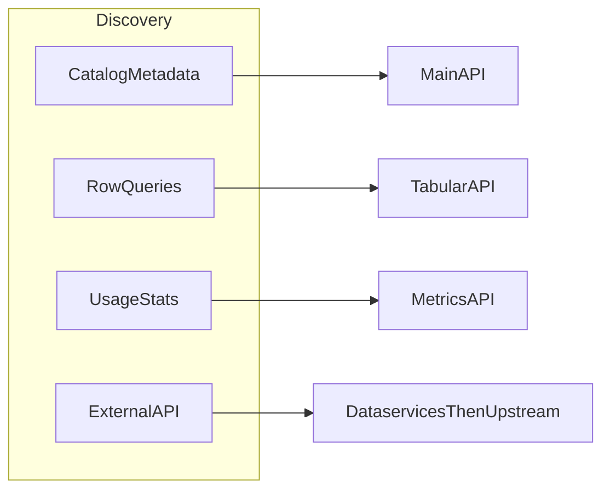

---

name: fr-gov-query-open-data-api
description: data.gouv.fr, Tabular CSV, datasets, usage metrics
version: 0.1.0
license: MIT
platforms: [linux, macos]
author: etalab-ia
metadata:
  hermes:
    tags: [data-gouv, open-data, api, dataservices, tabular, metrics, etat, gouv-fr]
    related_skills: [fr-gov-query-public-communication-data, fr-gov-rest-api-conventions, fr-gov-set-up-project-layout]
---

# Gouv-fr — API data.gouv.fr (Main, Metrics, Tabular)

> Source : [`etalab-ia/skills`](https://github.com/etalab-ia/skills) (`fr-gov-query-open-data-api`), adapté au préfixe `gouv-fr-`.

Three HTTP APIs (**Main**, **Metrics**, **Tabular**) plus **dataservices** (external HTTP APIs described on the platform; they used to be referenced on **api.gouv.fr** and are now **dataservices** on data.gouv.fr). This file is consumption-first: read paths and discovery; writes only when the user explicitly wants them and an API key is available.

---

## Quand utiliser

- Interroger le catalogue, les datasets, les organisations de data.gouv.fr.
- Télécharger un fichier, requêter des lignes CSV (Tabular), lire les métriques
  d'usage ou décrire un dataservice.

Pour les données du SIG spécifiquement, voir `fr-gov-query-public-communication-data`.

## How to use this skill

- **MCP first:** If the client exposes **data.gouv.fr MCP** tools, use them for conversational catalog exploration; they orchestrate the same platform capabilities with typed tool calls. For **dataservices** in particular, **`search_dataservices`** matches the intent of `GET /dataservices/`; after a hit, load the detail record (`machine_documentation_url`, `base_api_url`, etc.) via MCP or via `GET /dataservices/{id}/` before calling the upstream API. Endpoint: `https://mcp.data.gouv.fr/mcp`. Repos: [datagouv-mcp](https://github.com/datagouv/datagouv-mcp), [datagouv-skill](https://github.com/datagouv/datagouv-skill). Tool names vary by server version—follow the host’s tool list and fall back to the HTTP endpoints in this document when MCP is missing or insufficient (dataservices: `GET https://www.data.gouv.fr/api/1/dataservices/` with `q`, filters, and `next_page`, then `GET /dataservices/{id}/`).
- **HTTP otherwise:** Use the Main, Metrics, and Tabular base URLs below. Prefer **GET** responses over assumptions: do not invent dataset or resource IDs; cite **slugs**, **UUIDs**, and **URLs** returned by the API.
- **Automation vs chat:** MCP suits interactive exploration; the **Main API** suits reproducible scripts and the full route surface.
- **Writes (atypical):** Never log or echo `X-API-KEY`. Use POST/PUT/PATCH/DELETE only with clear user intent **and** a configured key. On **401/403**, distinguish missing key from insufficient permissions; on **404**, re-check id vs slug and use search. Do not expand into full producer pipelines here.

---

## Choosing an API (intent → surface)

| User goal | Use |
|-----------|-----|
| Search or read catalog metadata, resources, orgs, reuses, discussions | **Main API** — e.g. `GET /datasets/`, `GET /datasets/{id}/`, resources under the dataset |
| Filter/sort/paginate **rows** of a CSV resource hosted for Tabular | **Tabular API** — after steps in [§3 Tabular API](#3-tabular-api) |
| Platform **usage / statistics** (models such as `datasets`, `organizations`, `site`, `resources`) | **Metrics API** — see Swagger for `{model}` and column filters |
| Call an **external** API (legacy catalog: api.gouv.fr; now **dataservices** on data.gouv.fr) | **Dataservices** — MCP **`search_dataservices`** or `GET /dataservices/`, then `machine_documentation_url` + `base_api_url` (steps in [§1 Main API](#1-main-api)) |

---

## Identifiers and catalog visibility

- **Technical UUID vs slug:** Both work in many paths; **prefer the UUID** from API responses for stable automation.
- **Resolve before Tabular:** Tabular `{rid}` is the resource **UUID** from `GET /datasets/{id}/` (or `.../resources/`). If you only have a slug, `GET` the dataset first and read `resources[].id`.
- **Stable resource link:** `GET /datasets/r/{id}/` redirects to the latest resource for that id.
- **Search is not “the whole web”:** `GET /datasets/` supports filters such as **`archived`**, **`deleted`**, **`private`**. Defaults may hide some records; set query params explicitly when the user needs a full picture and the key allows it.

---

## Pagination and rate limits

- Lists return `data`, `page`, `page_size`, `total`, `next_page`, `previous_page`. Follow **`next_page`** until empty instead of guessing page counts.
- Use a **reasonable `page_size`**; avoid hammering the service or downloading the entire catalog page by page without need.
- Respect **`X-RateLimit-Limit`**, **`X-RateLimit-Remaining`**, **`X-RateLimit-Reset`**: slow down or backoff when remaining is low.

---

## Demo vs production

- **Production:** `https://www.data.gouv.fr/api/1/` (and production Metrics / Tabular hosts below).
- **Demo:** `https://demo.data.gouv.fr/api/1/` — for tests only; do not present demo results as production facts unless the user asked for demo.

---

## Glossary

- **Dataset:** A catalog entry (metadata, licence, frequency, tags) grouping **resources**.
- **Resource:** A file or API link attached to a dataset (CSV, JSON, GeoJSON, etc.); each has an id used by Tabular when the file is tabular-compatible on the platform.
- **Organization / producer:** Publisher entity; datasets may belong to an organization.
- **Reuse:** A project or article that references platform datasets or dataservices.
- **Dataservice:** A documented external HTTP API (OpenAPI/Swagger often at `machine_documentation_url`) with a **`base_api_url`** for calls. Same class of APIs that were once referenced on **api.gouv.fr**; the catalog entry on the open data platform is now a **dataservice**.
- **Slug:** Human-readable id in URLs; may change; UUID is safer for scripts.

---

## Producer coaching (documentation and publication quality)

When the user asks how to **prepare, document, or legally qualify** data for publication on data.gouv.fr **without** using write APIs here, **ground** answers in the official guides (fetch pages if the client allows, otherwise give links): [Guide qualité](https://guides.data.gouv.fr/guides/guide-qualite.md), [Guide juridique](https://guides.data.gouv.fr/guides/guide-juridique.md). This skill is **not** legal advice; encourage human review for obligations and licensing.

---

## Intent routing (optional)

---

## Metrics API

**Base URL:** `https://metric-api.data.gouv.fr` | Swagger: https://metric-api.data.gouv.fr/api/doc

| Method | Path | Description |
|--------|------|-------------|
| GET | `/api/{model}/data/` | Paginated metrics rows (JSON). Params: page, page_size, column__sort, column__exact, column__contains, column__less, column__greater |
| GET | `/api/{model}/data/csv/` | Metrics **export** for `{model}` as CSV (same column filters as JSON where applicable; **not** the Tabular API resource CSV format) |
| GET | `/health/` | Health check |

`{model}` = table name, **au pluriel** pour les entités de catalogue : `datasets`, `organizations`, `resources` (plus `site`). Vérifié le 2026-09-30 — `dataset`/`organization`/`resource` au singulier renvoient **404**. Voir le Swagger pour la liste et les colonnes.

---

## Tabular API

**Base URL:** `https://tabular-api.data.gouv.fr` | Swagger: https://tabular-api.data.gouv.fr/api/doc | Per-resource: `GET /api/resources/{rid}/swagger/`

`{rid}` = resource UUID from main API (dataset's resources).

**Tabular data workflow (use in order):**

1. `GET /api/resources/{rid}/` — confirm the resource is exposed and get links.
2. `GET /api/resources/{rid}/profile/` — column types, stats, indexes.
3. `GET /api/resources/{rid}/swagger/` — allowed query params and operators per column (read before complex filters).
4. `GET /api/resources/{rid}/data/` — `page` and `page_size` (max **50**). For aggregations, check `/api/aggregation-exceptions/` first (only listed resources/columns may support groupby/count/sum, etc.).

| Method | Path | Description |
|--------|------|-------------|
| GET | `/api/resources/{rid}/` | Metadata, links to profile/data/swagger |
| GET | `/api/resources/{rid}/profile/` | Column types, formats, stats, indexes |
| GET | `/api/resources/{rid}/swagger/` | OpenAPI for data endpoint (columns, operators) |
| GET | `/api/aggregation-exceptions/` | Resource UUIDs allowed for aggregation |
| GET | `/api/resources/{rid}/data/` | Filter, sort, paginate (page, page_size max 50) |
| GET | `/api/resources/{rid}/data/csv/` | Stream CSV |
| GET | `/api/resources/{rid}/data/json/` | Stream JSON |
| GET | `/health/` | Health check |

**Data params:** `columns=col1,col2` | Filter: `column__exact`, `__differs`, `__isnull`, `__isnotnull`, `__contains`, `__notcontains`, `__in`, `__notin`, `__less`, `__greater`, `__strictly_less`, `__strictly_greater` | Sort: `column__sort=asc|desc` | Aggregation (allowed resources, indexed cols): `column__groupby`, `__count`, `__avg`, `__min`, `__max`, `__sum`. JSON columns: only isnull/isnotnull.

---

## References and freshness

- **Main API Swagger (authoritative paths):** https://www.data.gouv.fr/api/1/swagger.json  
- **Metrics / Tabular:** use their Swaggers linked above. If a path or parameter disagrees with this file, **trust the live Swagger**.
- **API guide (human, technical):** [Prise en main](https://guides.data.gouv.fr/api-de-data.gouv.fr/prise-en-main.md), [Référence API](https://guides.data.gouv.fr/api-de-data.gouv.fr/reference.md), [Télécharger le catalogue](https://guides.data.gouv.fr/api-de-data.gouv.fr/telecharger-le-catalogue-de-donnees-de-data.gouv.fr.md), [SPARQL](https://guides.data.gouv.fr/api-de-data.gouv.fr/acceder-au-catalogue-via-sparql.md).

For sharing with humans, dataset pages on `www.data.gouv.fr` use slugs from API fields; **metadata and ids** should still come from **GET** responses.

## Renvois

- [Main API](references/main-api.md) — jeux de données, ressources, recherche,
  filtres, facettes et schémas.
- [Exemples rapides](references/exemples.md) — requêtes prêtes à copier.
